# guest-tv: the agentic guest TV

A welcome screen for guests on your TV, and a **Guest remote** on their phone with an AI agent
built in. Guests scan a code and can control the TV, run the aircon and lights in their room, put
music on, ask what to watch, check the weather, and find (and book) somewhere for dinner. The agent
is locked down, so a guest can't talk it into anything you haven't allowed. Open source (MIT).
Built with Claude.

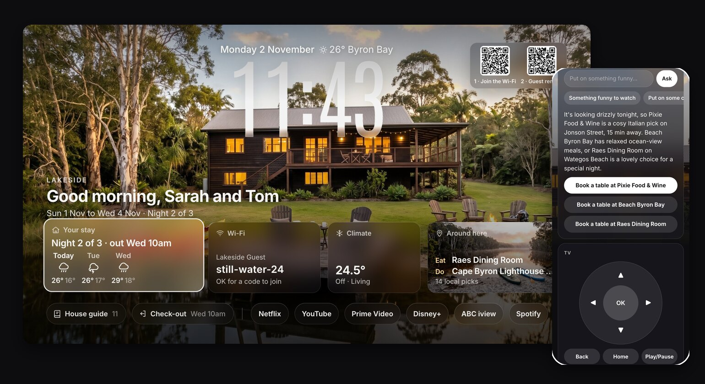

## What guests see

Two layouts, one setup. A **guest room** for friends and family: welcome, Wi-Fi, their room, the
weather and local picks, with no check-in, check-out or house rules. A **stay** for an Airbnb or a
holiday home: the guest's name (read from the Airbnb booking email), their dates, the door code only
during the stay, house rules and the check-out steps. The screen changes with each moment of a stay.

| Guest room | Arrival day | During the stay |
|---|---|---|
| 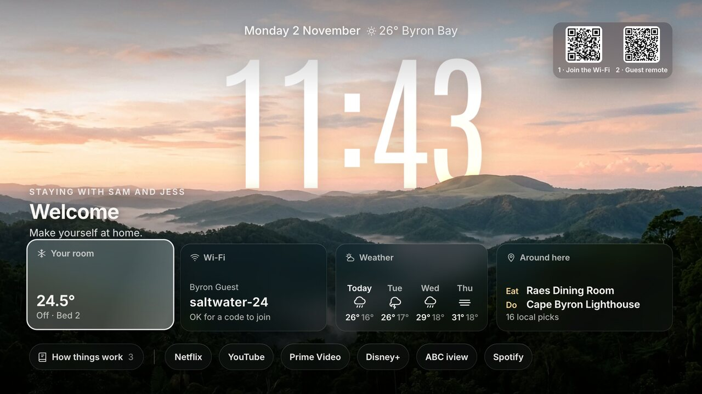 | 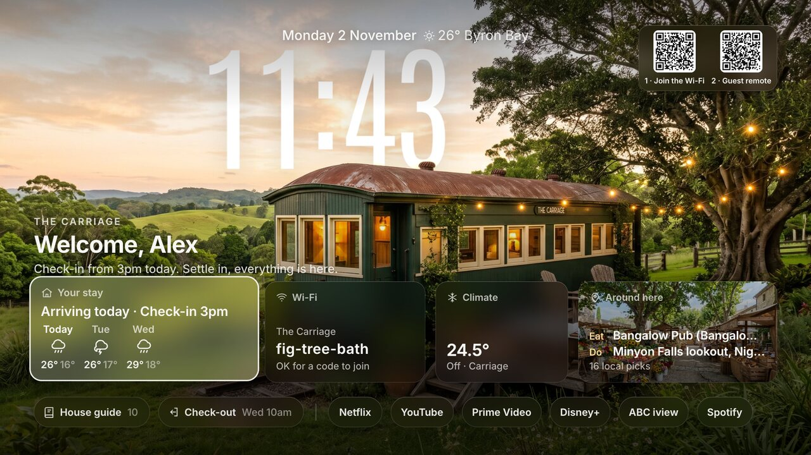 | 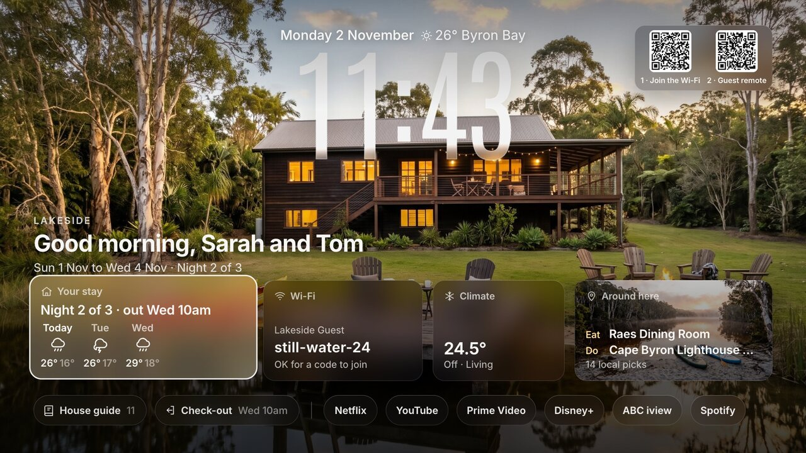 |
| **Last day** | **Between guests** (nothing private on screen) | |
| 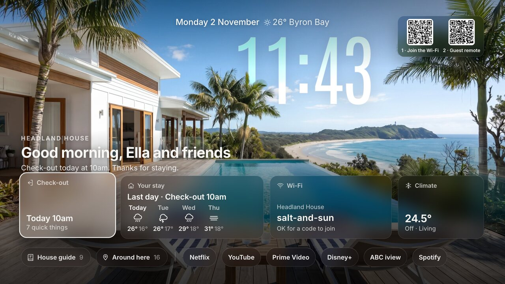 | 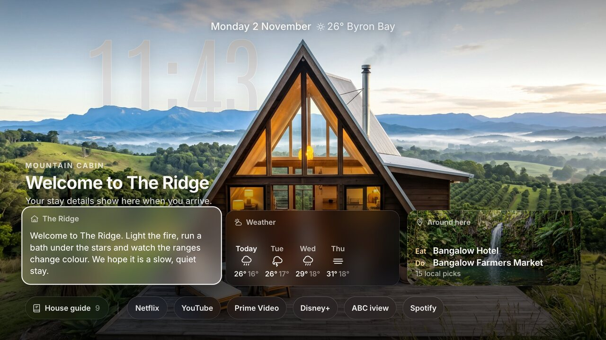 | |

Shown with demo homes and demo guests around Byron Bay. They come with the code: open
`/tv/?home=lake`, `ridge`, `carriage` or `headland`, and add `&phase=arrival`, `lastday` or
`between` to see each moment.

## The Guest remote

The TV shows two codes: **1 · Join the Wi-Fi**, then **2 · Guest remote**. The remote opens in the
guest's phone browser, with nothing to install, and only works on your Wi-Fi.

| The remote | Their room | House info |
|---|---|---|
| 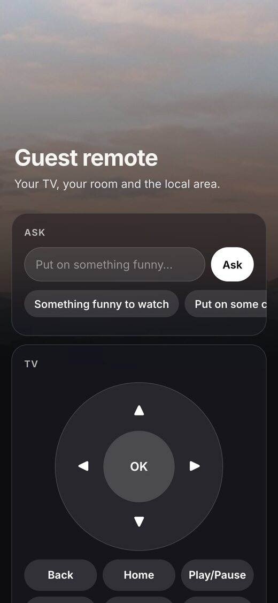 | 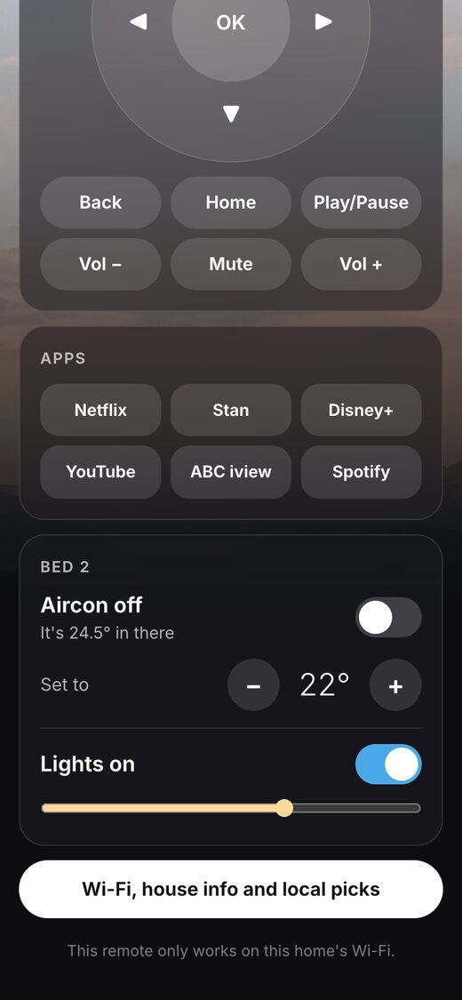 | 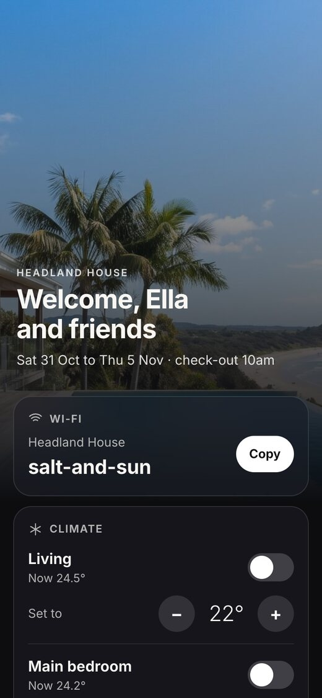 |
| **"Where's good for dinner tonight?"** | **"Book us a table at Pixie for 2"** (Open level) | |
| 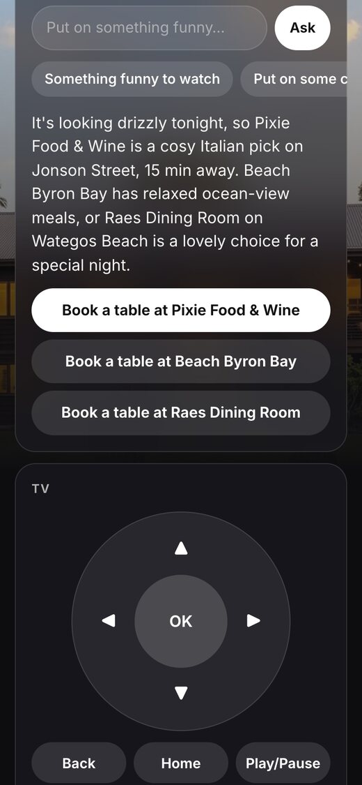 | 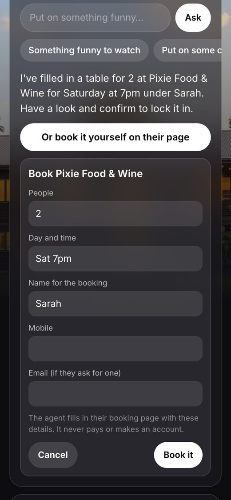 | |

- The **Ask** box: "put on that show about the lawyer who never went to uni", "chill music", "make
  my room cooler", "dim the lights", "will it rain tomorrow?", "where's good for dinner?"
- A D-pad, Back, Home, play and volume, the TV's streaming apps, and a card for each room they may
  control (aircon, lights).
- Dinner answers come with a **Book a table** button for each place (its own booking page). At the
  Open level the agent can fill in the booking for them, after they check and tap **Book it**.

## Will it work on my TV?

| Your TV | Welcome screen | Guest remote and agent | Guest profile picker |
|---|---|---|---|
| **Google TV or Android TV** (TCL, Hisense, Sony, Philips, Kogan, Chromecast with Google TV and others) | Yes, with the couch-tv TV app | Yes | Yes (Stan tested; Netflix by profile position) |
| **Fire TV** | Not tried. The couch-tv TV app runs on Fire OS | Should work (it uses ADB), not tried | Not tried |
| **Samsung, LG** | Not tried. It is a web page, so the TV's browser may show it | No. The TV controls need ADB, which these TVs do not have | No |

Built and tested on a TCL and a Toshiba, both Android TV 11, in November 2026. If you run it on
something else, please open an issue saying how it went.

## Setting it up with an AI agent

Open this folder in Claude Code (or any coding agent) and say "set this up on my TV". It reads
[AGENTS.md](AGENTS.md), runs the checks, and walks you through the same questions `setup.py` asks:
your place, your TV, what guests may control, and how much the agent may do. It never signs in to
anything for you and never picks the Open level for you.

## What you need

- **A Google TV or Android TV** with Developer options and debugging on (step 1).
- **A computer that stays on**, on the same Wi-Fi: a Mac, a Linux box or a Raspberry Pi. It runs the
  TV page, the remote and the agent, so it must never sleep. **Python 3.10 or newer**
  (`python3 --version`; tested on 3.11). Missing or older: on macOS `brew install python@3.11` or
  the installer from python.org; on Linux your distribution's package (for example
  `sudo apt install python3.11 python3.11-venv`).
- **Claude Code**, installed and signed in on that computer. The agent runs `claude -p` on your own
  Claude plan, with `ANTHROPIC_API_KEY` stripped first, so it never bills an API key.
- **One Wi-Fi.** The TV, the aircon, the lights, the computer and the guest's phone all on it.
- **The couch-tv TV app**, `couch-tv-home.apk`, from the
  [couch-tv Releases page](https://github.com/Seagey/couch-tv/releases). It shows guest-tv full
  screen and opens the TV's real apps from it.
- Optional: **AirTouch 5** aircon, smart lights through **Home Assistant** or **Philips Hue**,
  **Spotify** on the TV, and **Node.js 20+** and Google Chrome for agentic booking.

## Setup

### Step 1. Developer mode on the TV

1. On the TV: **Settings, System, About**. Move to **Android TV OS build** (or **Build**) and press
   OK seven times, until it says you are a developer.
2. Back in **Settings, System**, open **Developer options** and switch on **USB debugging** (on some
   TVs it is called **Network debugging** or **ADB debugging**).
3. Find the TV's address: **Settings, Network and Internet**, your Wi-Fi, **IP address**. Use this
   number everywhere below, not a `.local` name.

The first time the computer connects, the TV asks "Allow USB debugging?". Tick **Always allow** and
press **OK**.

### Step 2. Get the code and set up Python

```bash
git clone https://github.com/Seagey/guest-tv && cd guest-tv
python3 -m venv .venv && .venv/bin/pip install -r requirements.txt
```

### Step 3. Answer the setup questions

```bash
.venv/bin/python setup.py
```

It checks the must-haves first (Claude Code signed in, the computer never sleeps, the packages, the
ADB key, the TV answers) and says how to fix anything missing. Then it asks: a guest room or a
stay, the host's name, the guest Wi-Fi, the Airbnb calendar link (stays only), the TV's address,
which rooms guests may control for the aircon and the lights, which streaming apps are signed in,
and the agent level. Run it again any time to change an answer; `setup.py --check` only checks.

### Step 4. Run it, and keep it running

```bash
.venv/bin/python server.py
```

To start it on boot and restart it if it stops: `service/guest-tv.plist` (Mac) or
`service/guest-tv.service` (Linux). Each file says how to install it.

### Step 5. Put it on the TV

```bash
TV_IP=<tv address> .venv/bin/python tools/tv_app.py install couch-tv-home.apk
TV_IP=<tv address> .venv/bin/python tools/tv_app.py home --home guest
```

`install` puts the couch-tv TV app on the TV. `home` writes down the TV's current home screen, then
makes the app the home and opens guest-tv in it, so the Home button always comes back to the welcome
screen. Use `open` instead of `home` to show it without changing the home. Use your home's id
(`guest`, or the one you gave a stay in step 3). If the computer has more than one address, add
`--url http://<this computer's address>:5410`. `status` shows what is on the TV now.

### Step 6. Try it

Scan the **Guest remote** code on the TV with your phone and ask for something. Then test the guard
rails yourself: `.venv/bin/python tools/agent_test.py` (73 asks, about 6 minutes; every one must
pass) and the code checks with no AI: `.venv/bin/python tools/devices_test.py`.

## Undo

```bash
TV_IP=<tv address> .venv/bin/python tools/tv_app.py undo            # the old home screen is back
TV_IP=<tv address> .venv/bin/python tools/tv_app.py undo --remove   # and the TV app is removed
```

Then stop the service if you installed one (Mac: `launchctl bootout gui/$(id -u)/guest-tv`; Linux:
`sudo systemctl disable --now guest-tv`). Nothing on the TV was switched off or deleted, so there is
nothing else to put back. With only the TV remote: in **Settings, Apps**, find the default **Home**
app setting (the menu name varies by TV) and pick the old home.

## What guests can control

`setup.py` asks this, or set it yourself. The TV is always included.

| Device | How | Set in |
|---|---|---|
| Aircon | AirTouch 5 on your Wi-Fi | `settings.json` `"aircon"` |
| Lights | Home Assistant (covers Hue, LIFX, TP-Link, Govee, Nanoleaf and most others) or Philips Hue direct | home `"lights"` |
| Anything else | your own buttons, agent level Plus (below) | `data/actions.json` |

Which rooms, per device, in the home as `"control"`:

```json
"control": { "aircon": "their room", "lights": "all" }
```

`"their room"` (the room in the home's `"room"`, best for a guest room), `"all"` (the guest has the
whole place), a list such as `["Living", "Deck"]`, or `"none"`. Lights look like this:

```json
"lights": { "kind": "home_assistant", "url": "http://homeassistant.local:8123",
            "rooms": { "Bed 3": ["light.bed_3_lamp"], "Living": ["light.lounge", "light.dining"] } }
```

The Home Assistant token (`ha_token`) or Hue key (`hue_user`) goes in `data/private.json`. A room with
lights gets a Lights card on the remote (on, off, brightness), and the agent can dim or switch them.
Rooms with no smart lights show nothing.

## Agent levels: how much the agent may do

Whatever the agent can do, a guest can try to talk it into. So you choose. In `settings.json`:
`"agent": {"level": "locked"}` (the default).

| Level | What it can do | The risk |
|---|---|---|
| **Locked** (default) | The TV, music, the devices and rooms you picked, the weather and your area. Dinner answers get a **Book a table** button that opens the restaurant's own booking page. The guest books it themselves. | None outside that list. The AI has no tools at all. It picks from a short menu and the code checks every pick. |
| **Plus** | Locked, plus your own buttons in `data/actions.json` (start from `actions.example.json`): a webhook (n8n, Zapier, Home Assistant) or a Home Assistant script. Each has typed settings the code checks, and `"confirm": true` makes the guest tap Confirm first. | Only what your buttons do. Only add what you'd let any guest press. |
| **Open** | Plus, and the AI gets web search and any tools you plug in (MCP servers). It can **book a table for the guest**: it fills in the restaurant's booking page in a browser. | A clever guest can get it to do anything those tools can do. It also uses more of your Claude plan, and asks take longer (about 20 to 40 s). |

Never at any level: shell commands, your files, your computer, other devices on your Wi-Fi.

### Agentic booking (Open level)

`setup.py` turns this on for you. By hand:

1. Install Node.js (for `npx`). Google Chrome on the computer, or run `npx playwright install chromium` once.
2. `data/booking-mcp.json`:
   ```json
   { "mcpServers": { "browser": { "command": "npx",
       "args": ["-y", "@playwright/mcp@0.0.84", "--headless", "--isolated", "--browser", "chrome"] } } }
   ```
3. `settings.json`:
   ```json
   "agent": { "level": "open", "open": { "web": true },
              "booking": { "mcp_file": "booking-mcp.json", "allowed_tools": ["mcp__browser"] } }
   ```
4. Give each restaurant in your house guide its booking page as `"book"` (`guide_writer.py` finds these).

How it goes: the guest asks "book us a table at Pixie for 2 at 7 on Saturday". The remote shows a card
with the place, people, time and name. The guest checks it and taps **Book it**. Only then does the
agent open the restaurant's booking page and fill it in. It works with whatever the restaurant uses
(its own form, SevenRooms, OpenTable, Resy, Tock and others), in any country.

What it will never do: pay, type a card number, make an account, sign in, or tick a newsletter box.
If a booking needs any of those, or the time is taken, it stops and tells the guest (with nearby
free times), and the guest gets the booking page instead. It only books places in your guide.

Prefer a booking service's own tool? If one in your area has an MCP server, list it in
`booking-mcp.json` instead and put its tool names in `allowed_tools`.

Test it without bothering a real restaurant: `.venv/bin/python tools/booking_agent_test.py` (a
pretend restaurant on your computer: a normal booking, a card deposit, and a full time slot).

## More about the Guest remote

- Stay homes get a new link for each booking, and it stops at check-out. The guest room's link lasts
  until you reset it: `POST /api/remote/reset?home=guest&key=<host_key>`.
- 20 asks an hour per guest, one at a time.
- Music is Spotify on the TV, signed in to your account. A music ask takes about 45 seconds, because
  Spotify's TV app has to be stepped through by its Search page.
- List the apps you are signed in to as `"guest_apps"` in `data/settings.json` (for example
  `["stan", "netflix", "youtube"]`). Others are hidden, so a guest never lands on a login screen.

## Airbnb bookings

Put your listing's calendar link (Airbnb: Calendar, Availability, Connect calendars, Export) in the
home as `calendar_url` (`setup.py` asks for it). The TV then knows each booking's dates and shows
check-in and check-out.

Airbnb leaves the guest's name out of that link. To get it, guest-tv reads Airbnb's booking emails:

- **Easiest:** forward or save each "Reservation confirmed" email as a `.eml` file into
  `data/bookings-inbox/`.
- **Hands-free:** let it read your mailbox (read only). In `data/settings.json`:
  `"bookings": {"imap": {"host": "imap.gmail.com", "user": "you@example.com"}}`, and put an
  app password (not your normal password) in `data/private.json` as `"bookings_password"`.

It takes the guest's first name and how many are coming, and a cancel email takes them off again.
A name you type in the host panel always wins. Check what it found:
`/api/bookings?key=<host_key>&now=1`. Test it with no Airbnb account: `.venv/bin/python tools/booking_test.py`.

## Host panel

`/p/?home=guest&key=<host_key from data/private.json>` adds a box to set the guest's name and dates.

## Your house guide, written by AI

```bash
.venv/bin/python guide_writer.py --area "Bangalow, NSW" --home "a railway carriage cabin for 2" \
  --notes my-notes.md --out data/homes/carriage/guide.json
```

Set `--area` to where your home is. Paste whatever you have into the notes file (or nothing).
Claude leads with places to eat and things to do, checks every local place on the web (and its
booking page), and never invents a phone number. Read it and edit it before guests see it.

## Guest profiles in streaming apps

When a guest opens Netflix, Stan, Prime Video or Disney+, the TV picks the **Guest** profile for them,
so they never land in yours and your watch history stays yours.

**You do this once, in each app** (the TV cannot make profiles or sign in for you):

1. Sign in to each streaming app on the guest TV yourself.
2. In each app, add a profile called **Guest**. If the app is full (Stan and Netflix allow 5), rename
   one you do not use.
3. Tell your agent it is done. It checks each app with `tools/tvui.py` and says which ones work.

The setting lives in `data/settings.json` under `profiles`:

```json
"profiles": {
  "on": true,
  "tv": "<the TV's IP address>",
  "names": ["Guest", "Guests", "Visitor", "Visitors"],
  "blind": { "com.netflix.ninja": { "position": 3 } }
}
```

- `tv`: the TV's address. Use the number, not a `.local` name (two devices can share one).
- `names`: what a guest profile may be called. Add your own word if you use another one.
- `blind`: for apps that hide their screen from the computer (Netflix does), the guest profile's
  place in the row (1 = first). Used only when the app has just started and nothing is playing.

What it did shows at `/api/profiles` and in `logs/profiles.log`.

## Film mode

Filming a video of your setup? Set `"film": true` in `data/settings.json`. Each home's `film.json`
(if it has one) then replaces the host's name, the Wi-Fi and anything else you list, so nothing
private shows on camera. Set it back to `false` when you're done.

## How it fits together

```
guest's phone (/r/ Guest remote, /p/ house info)
        |
        v
this computer: server.py ----> the TV (ADB: keys, apps, shows, Spotify, the Guest profile)
        |        |      \----> aircon (AirTouch 5) and lights (Home Assistant, Hue)
        |        v
        |   guest_agent.py: claude -p, no tools (Locked); the code checks every pick
        v
the TV: couch-tv TV app shows /tv/ (the welcome screen)
```

| Path | What it is |
|---|---|
| `server.py` | the pages and the API behind them |
| `guest_agent.py` | the agent behind the Ask box, and the code that checks what it picks |
| `tvctl.py` | TV control over ADB, from fixed tables of keys and apps |
| `devices.py` | smart lights (Home Assistant, Hue) and your own actions |
| `profiles.py` | picks the Guest profile when a streaming app asks "Who's watching?" |
| `bookings.py` | reads Airbnb booking emails for the guest's name and how many are coming |
| `setup.py` | the setup questions (and `--check` for the must-haves) |
| `guide_writer.py` | writes `guide.json` with Claude from your notes and the area |
| `data/homes/<id>/` | each home: `home.json` (name, photos, rooms, dates) and `guide.json` (welcome, rules, how-to, local picks, check-out) |
| `data/settings.json` | port, weather place, aircon, TV, apps, agent level |
| `data/private.json` | your Wi-Fi, codes, guest names, tokens, host key. Made on first run, never in git |
| `data/actions.example.json` | example buttons for agent level Plus |
| `tools/` | `tv_app.py` (put it on the TV), `tvui.py` (step through the TV by hand), the tests |
| `service/` | keep it running on a Mac (launchd) or Linux (systemd) |
| `web/` | the TV page, the phone pages, fonts and the demo photos |

## Privacy and safety

- Your Wi-Fi, door codes, guest names and tokens are in `data/private.json`. Your own buttons and
  booking setup are in `data/actions.json` and `data/booking-mcp.json`. All three are ignored by git.
- Before you push a fork, run `scripts/privacy-scan.sh`. It checks for private addresses, emails,
  phone numbers, MAC addresses, home network names and secrets, in the files and the git history.
  Give it a file of your own words to block: `scripts/privacy-scan.sh my-denylist.txt` (one word per
  line, keep that file out of the repo).
- The Guest remote only answers with the code from the TV, and a stay's code stops at check-out.
  Anyone on your Wi-Fi who scans the TV can use it, so put guests on a guest network if you can.
  Do not forward a port to this computer.
- The door code only shows on the TV during a stay. Between stays nothing private is on screen.
- Agent levels: see above. Locked is the default, and the guard rail tests are in the repo.

## Limits

- The TV controls need ADB, so they work on Google TV and Android TV. Samsung and LG are not
  supported.
- Some Google TV models keep Google's own home on the Home button even after `tools/tv_app.py home`.
  couch-tv's `apply.sh` can switch Google's home off if you need that.
- Aircon is AirTouch 5 only so far. Other aircon can be added as your own action (Plus level) through
  Home Assistant.
- Lights were tested against Home Assistant and Hue stand-ins, not real bulbs. Please open an issue
  if yours behave differently.
- The agent's knowledge of shows stops at its training date. Very new shows work by name, not always
  by description.
- Spotify music asks take about 45 seconds.
- No support promise. It works on the TVs it was built on. Your TV may differ.

## Credits

- The demo home photos (`web/homes/`) were generated for this project and are free to use.
- Fonts: Inter and Antonio (both SIL Open Font Licence).
- Where shows stream: JustWatch's public search (credit them if you publish anything built on this).
- Weather: Open-Meteo.
- The TV app and the glass look: [couch-tv](https://github.com/Seagey/couch-tv).

MIT licence, see `LICENSE`.
