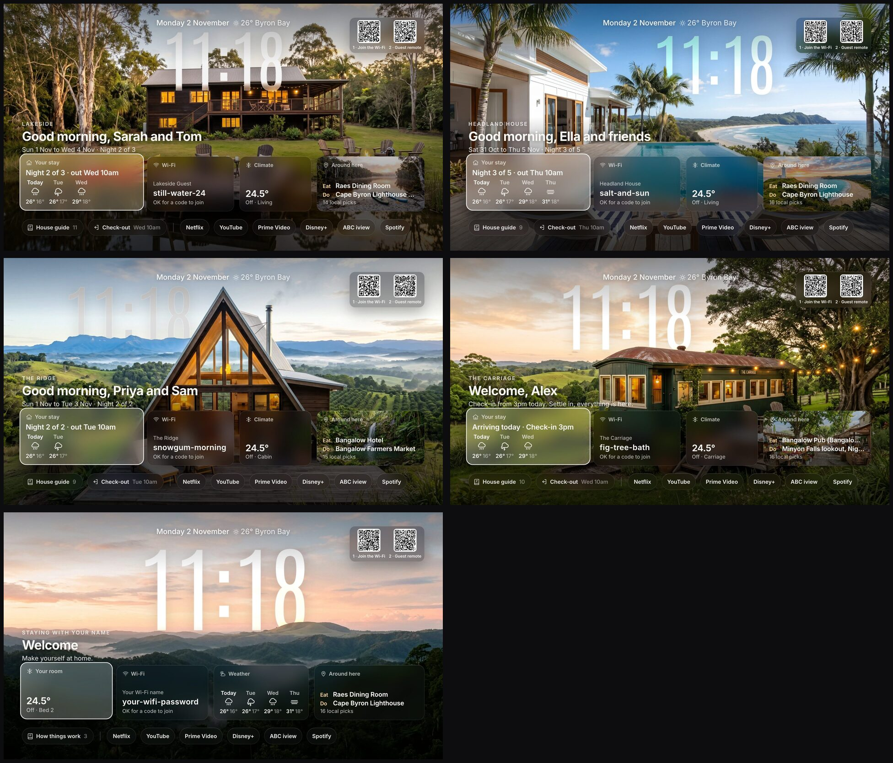
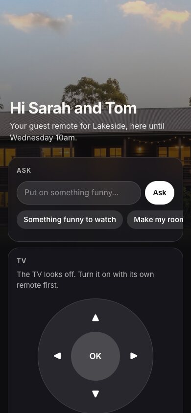
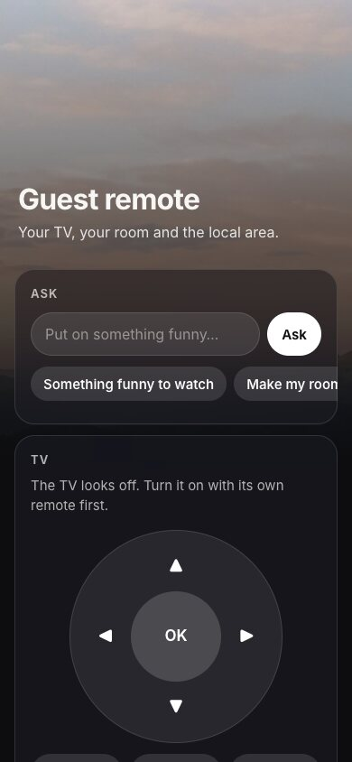

# guest-tv: the agentic guest TV

A welcome screen for guests on your TV, plus a **Guest remote** on their phone with an AI agent
built in. Guests scan a code and can control the TV, run the aircon and lights in their room, put
music on, ask what to watch, check the weather, and find (and book) somewhere for dinner. The agent
is locked down, so a guest can't talk it into anything you haven't allowed.

Two layouts, one setup:

- **Guest room** (friends and family): welcome, Wi-Fi, their room's aircon and lights, the weather,
  local picks, house notes. No check-in, check-out or house rules.
- **Stay** (Airbnb, holiday home): the guest's name (read from the Airbnb booking email), their
  dates, the weather for their stay, Wi-Fi, door codes only during the stay, house rules, check-out.



## What you need

- **A TV running Android TV or Google TV** (most TCL, Hisense, Sony, Kogan, Chromecast with Google TV).
- **A computer that stays on**: a Mac, a Linux box or a Raspberry Pi. It runs the TV page, the
  remote and the agent, so it must never sleep.
- **Claude Code, signed in** on that computer. The agent runs on your own Claude plan.
- **One Wi-Fi.** The TV, the aircon, the lights, the computer and the guest's phone all on the same
  Wi-Fi. The Guest remote only works on your Wi-Fi.
- **ADB on the TV** (Settings, System, About: press Build 7 times, then Developer options, USB
  debugging on), so the computer can press the TV's buttons.
- Optional: AirTouch 5 aircon, smart lights through Home Assistant or Philips Hue, Spotify on the TV.

## Set it up

```bash
git clone https://github.com/Seagey/guest-tv && cd guest-tv
python3 -m venv .venv && .venv/bin/pip install -r requirements.txt
.venv/bin/python setup.py      # questions: your place, TV, what guests may control, agent level
.venv/bin/python server.py
```

`setup.py` checks the must-haves first and tells you how to fix anything missing
(`setup.py --check` checks again any time). Run it again to change an answer. If you use an AI
agent (Claude Code), point it at [AGENTS.md](AGENTS.md) and it will walk you through the same
questions.

Then open `http://<your-computer>.local:5410/tv/?home=guest` on the TV, or try the demo homes
first: `lake`, `ridge`, `carriage`, `headland` (set around Byron Bay). Add `&phase=arrival`,
`lastday` or `between` to see each moment of a stay.

**Showing it on the TV:** install the [couch-tv](https://github.com/Seagey/couch-tv) TV app and set
its bridge to this computer (`http://<your-computer-ip>:5410`). It shows the page full screen and
opens the TV's real apps from it. The TV's own web browser works too, but its remote moves a mouse
pointer.

**Keep it running:** `service/guest-tv.plist` (Mac) and `service/guest-tv.service` (Linux) start it
on boot and restart it if it stops. Each file says how to install it.

## Files

| Path | What it is |
|---|---|
| `data/homes/<id>/home.json` | the home: name, photos, check-in and out, zones, demo stay |
| `data/homes/<id>/guide.json` | welcome, rules, how-to, local tips, check-out, emergency |
| `data/private.json` | real Wi-Fi, codes, guest names, host key. Stays on this computer (git ignores it) |
| `data/settings.json` | port, weather place, aircon kind and whether changes are sent |
| `setup.py` | the setup questions (and `--check` for the must-haves) |
| `devices.py` | smart lights (Home Assistant, Hue) and your own actions |
| `data/actions.example.json` | example buttons for agent level Plus |
| `bookings.py` | reads Airbnb booking emails for the guest's name and how many are coming |
| `profiles.py` | picks the Guest profile when a streaming app asks "Who's watching?" |
| `tools/tvui.py` | step through the TV by hand over ADB (read the screen, press keys) |
| `guide_writer.py` | writes `guide.json` with Claude from the host's notes and the area |
| `service/` | keep it running on a Mac (launchd) or Linux (systemd) |
| `scripts/privacy-scan.sh` | run before you publish a fork: checks for addresses, emails, keys |

## The AI guide writer

```bash
python3 guide_writer.py --area "Bangalow, NSW" --home "a railway carriage cabin for 2" \
  --notes my-notes.md --out data/homes/carriage/guide.json
```

Set `--area` to where your home is. Paste whatever you have into the notes file (or nothing).
Claude leads with places to eat and things to do, checks every local place on the web and never
invents a phone number. Read it and edit it before guests see it.

## Host panel

`/p/?home=guest&key=<host_key from data/private.json>` adds a box to set the guest's name and dates.

## What guests can control

`setup.py` asks this, or set it yourself. The TV is always included.

| Device | How | Set in |
|---|---|---|
| Aircon | AirTouch 5 on your Wi-Fi | `settings.json` `"aircon"` |
| Lights | Home Assistant (covers Hue, LIFX, TP-Link, Govee, Nanoleaf and most others) or Philips Hue direct | home `"lights"` |
| Anything else | your own buttons, agent level Plus (below) | `data/actions.json` |

Which rooms, per device, in the home as `"control"`:

```json
"control": { "aircon": "their room", "lights": "all" }
```

`"their room"` (the room in the home's `"room"`, best for a guest room), `"all"` (the guest has the
whole place), a list such as `["Living", "Deck"]`, or `"none"`. Lights look like this:

```json
"lights": { "kind": "home_assistant", "url": "http://homeassistant.local:8123",
            "rooms": { "Bed 3": ["light.bed_3_lamp"], "Living": ["light.lounge", "light.dining"] } }
```

The Home Assistant token (`ha_token`) or Hue key (`hue_user`) goes in `data/private.json`. A room with
lights gets a Lights card on the remote (on, off, brightness), and the agent can dim or switch them.
Rooms with no smart lights show nothing.

## Agent levels: how much the agent may do

Whatever the agent can do, a guest can try to talk it into. So you choose. In `settings.json`:
`"agent": {"level": "locked"}` (the default).

| Level | What it can do | The risk |
|---|---|---|
| **Locked** (default) | The TV, music, the devices and rooms you picked, the weather and your area. Dinner answers get a **Book a table** button that opens the restaurant's own booking page. The guest books it themselves. | None outside that list. The AI has no tools at all. It picks from a short menu and the code checks every pick. |
| **Plus** | Locked, plus your own buttons in `data/actions.json` (start from `actions.example.json`): a webhook (n8n, Zapier, Home Assistant) or a Home Assistant script. Each has typed settings the code checks, and `"confirm": true` makes the guest tap Confirm first. | Only what your buttons do. Only add what you'd let any guest press. |
| **Open** | Plus, and the AI gets web search and any tools you plug in (MCP servers). It can **book a table for the guest**: it fills in the restaurant's booking page in a browser. | A clever guest can get it to do anything those tools can do. It also uses more of your Claude plan, and asks take longer (about 20 to 40 s). |

Never at any level: shell commands, your files, your computer, other devices on your Wi-Fi.

### Agentic booking (Open level)

`setup.py` turns this on for you. By hand:

1. Install Node.js (for `npx`). Google Chrome on the computer, or run `npx playwright install chromium` once.
2. `data/booking-mcp.json`:
   ```json
   { "mcpServers": { "browser": { "command": "npx",
       "args": ["-y", "@playwright/mcp@0.0.84", "--headless", "--isolated", "--browser", "chrome"] } } }
   ```
3. `settings.json`:
   ```json
   "agent": { "level": "open", "open": { "web": true },
              "booking": { "mcp_file": "booking-mcp.json", "allowed_tools": ["mcp__browser"] } }
   ```
4. Give each restaurant in your house guide its booking page as `"book"` (`guide_writer.py` finds these).

How it goes: the guest asks "book us a table at Pixie for 2 at 7 on Saturday". The remote shows a card
with the place, people, time and name. The guest checks it and taps **Book it**. Only then does the
agent open the restaurant's booking page and fill it in. It works with whatever the restaurant uses
(its own form, SevenRooms, OpenTable, Resy, Tock and others), in any country.

What it will never do: pay, type a card number, make an account, sign in, or tick a newsletter box.
If a booking needs any of those, or the time is taken, it stops and tells the guest (with nearby
free times), and the guest gets the booking page instead. It only books places in your guide.

Prefer a booking service's own tool? If one in your area has an MCP server, list it in
`booking-mcp.json` instead and put its tool names in `allowed_tools`.

Test it without bothering a real restaurant: `.venv/bin/python tools/booking_agent_test.py` (a
pretend restaurant on your computer: a normal booking, a card deposit, and a full time slot).

## Guest remote

<p>

</p>

The TV shows two codes: **1 · Join the Wi-Fi**, then **2 · Guest remote**. The remote opens on the
guest's phone (it only works on your Wi-Fi) with:

- an **Ask** box: "put on that show about the lawyer who never went to uni", "chill music",
  "make my room cooler", "dim the lights", "will it rain tomorrow?", "where's good for dinner?"
- a D-pad, Back, Home, play and volume, the TV's streaming apps, and a card for each room they may
  control (aircon, lights).

**What a guest cannot do on the Locked level, even by asking cleverly:** rooms you didn't allow, other
TVs, anything else on your Wi-Fi, settings, installing or deleting apps, sign-ins, buying anything, or
getting the AI to write or build something. The AI behind the Ask box has no tools at all. It can only
pick from a short menu, and the code checks every pick before anything happens (`guest_agent.py`
explains how). Plus and Open add more, on purpose (see Agent levels).

- Stay homes get a new link for each booking, and it stops at check-out. The guest room's link lasts
  until you reset it: `POST /api/remote/reset?home=guest&key=<host_key>`.
- It runs on your own Claude plan (Claude Code signed in on this computer), never an API key.
  20 asks an hour per guest.
- Music is Spotify on the TV, signed in to your account. A music ask takes about 45 seconds.
- Set the TV's address as `"tv"` in `data/settings.json` (or per home), and list the apps you are
  signed in to as `"guest_apps"` (for example `["stan", "netflix", "youtube"]`). Others are hidden,
  so a guest never lands on a login screen.
- Test the guard rails yourself: `.venv/bin/python tools/agent_test.py` (73 asks, about 6 minutes),
  and the code checks with no AI: `.venv/bin/python tools/devices_test.py`.

## Film mode

Filming a video of your setup? Set `"film": true` in `data/settings.json`. Each home's `film.json`
(if it has one) then replaces the host's name, the Wi-Fi and anything else you list, so nothing
private shows on camera. Set it back to `false` when you're done.

## Airbnb bookings

Put your listing's calendar link (Airbnb: Calendar, Availability, Connect calendars, Export) in the
home as `calendar_url`. The TV then knows each booking's dates and shows check-in and check-out.

Airbnb leaves the guest's name out of that link. To get it, guest-tv reads Airbnb's booking emails:

- **Easiest:** forward or save each "Reservation confirmed" email as a `.eml` file into
  `data/bookings-inbox/`.
- **Hands-free:** let it read your mailbox (read only). In `data/settings.json`:
  `"bookings": {"imap": {"host": "imap.gmail.com", "user": "you@example.com"}}`, and put an
  app password (not your normal password) in `data/private.json` as `"bookings_password"`.

It takes the guest's first name and how many are coming, and a cancel email takes them off again.
A name you type in the host panel always wins. Check what it found:
`/api/bookings?key=<host_key>&now=1`. Test it with no Airbnb account: `.venv/bin/python tools/booking_test.py`.

## Guest profiles in streaming apps

When a guest opens Netflix, Stan, Prime Video or Disney+, the TV picks the **Guest** profile for them,
so they never land in yours and your watch history stays yours.

**You do this once, in each app** (the TV cannot make profiles or sign in for you):

1. Sign in to each streaming app on the guest TV yourself.
2. In each app, add a profile called **Guest**. If the app is full (Stan and Netflix allow 5), rename
   one you do not use.
3. Tell your agent it is done. It checks each app with `tools/tvui.py` and says which ones work.

The setting lives in `data/settings.json` under `profiles`:

```json
"profiles": {
  "on": true,
  "tv": "<the TV's IP address>",
  "names": ["Guest", "Guests", "Visitor", "Visitors"],
  "blind": { "com.netflix.ninja": { "position": 3 } }
}
```

- `tv`: the TV's address. Use the number, not a `.local` name (two devices can share one).
- `names`: what a guest profile may be called. Add your own word if you use another one.
- `blind`: for apps that hide their screen from the computer (Netflix does), the guest profile's
  place in the row (1 = first). Used only when the app has just started and nothing is playing.

What it did shows at `/api/profiles` and in `logs/profiles.log`. Full notes for agents:
[AGENTS.md](AGENTS.md).
